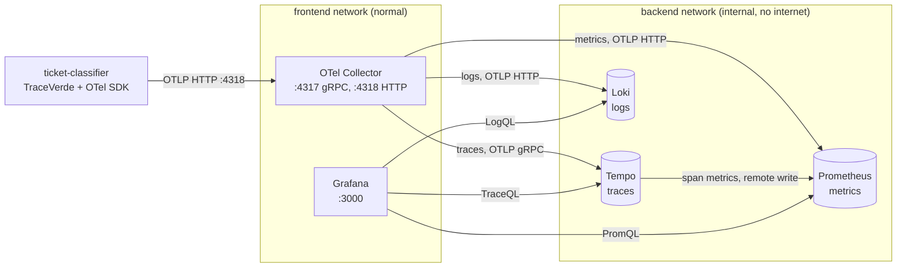
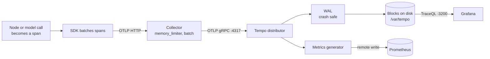
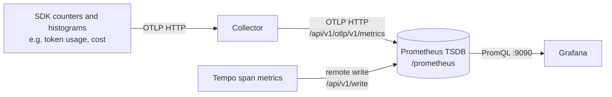
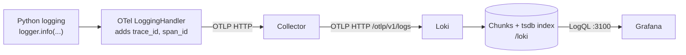
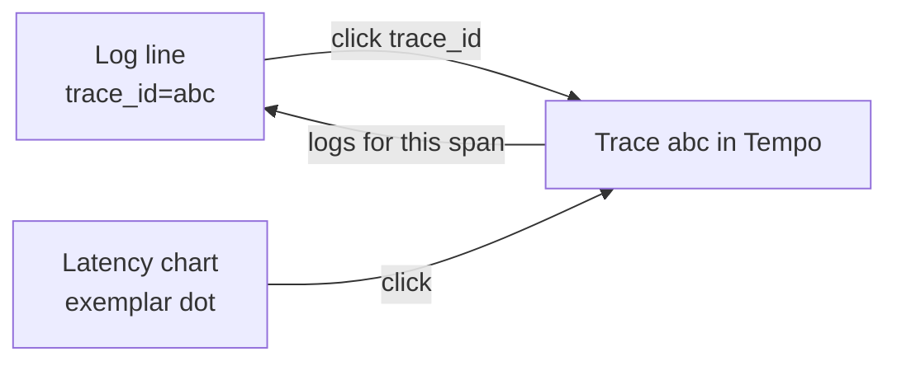

# Monitoring stack

Local only observability for the ticket classifier: metrics, traces and logs, sent with
OpenTelemetry (OTLP), stored on this machine and shown in Grafana. Nothing leaves the
machine. Build plan: [docs/exercises/plan_w8d5.md](../docs/exercises/plan_w8d5.md).

## Commands

Run from `ticket-classifier/`:

```sh
make obs-up      # start the stack; Grafana at http://localhost:3000 (user admin)
make obs-check   # OK / FAIL per service, with the reason on failure
make obs-usage   # disk usage per volume
make obs-down    # stop the stack; data is kept
```

`docker compose -f monitoring/docker-compose.yml down -v` also deletes all stored
metrics, traces, logs and Grafana data.

Grafana login: user `admin`. The first password is `GRAFANA_ADMIN_PASSWORD` (default
`admin`); Grafana asks to change it on first login. The changed password is stored in
the `grafana-data` volume, so the variable has no effect after the first start.

Variables for the stack, such as `GRAFANA_ADMIN_PASSWORD`, go in `monitoring/.env`
(git-ignored), which compose reads. Not in the app's `.env`: the app rejects unknown
keys there.

## Overview



- The app pushes everything to one place, the collector. It never talks to a store.
- The collector splits the data by signal and pushes each to its store.
- Grafana only reads: it queries each store with that store's query language.
- Host ports (all on `127.0.0.1`): `4317`, `4318` and `13133` (collector health), and
  `3000` (Grafana). Prometheus, Tempo and Loki have no host ports.

## The three signals

| Signal | What it answers | Example |
| --- | --- | --- |
| Trace | What happened in one run, step by step, how long each step took | ticket T-3: `get_customer` 2 ms, `triage` 1.8 s, `human_review` paused |
| Metric | How much, how often, over time (numbers only) | tokens per hour, cost per day, p95 latency of `triage` |
| Log | What a step said, as text with attributes | `Ticket T-3 waits for a human` |

A trace is a tree of **spans**. A span is one timed step (a node, a model call) with a
name, start, duration, status and attributes. All spans of one run share a `trace_id`.

### Traces



- **Generated by:** TraceVerde (Anthropic calls, LangGraph) and our own wrapper for
  nodes (step 14).
- **Stored:** Tempo first writes spans to a write-ahead log (WAL), then packs them into
  compressed blocks.
- **Extra:** the metrics generator turns spans into metrics (call count, errors and
  latency per span, and a service graph) and pushes them to Prometheus.

### Metrics



- **Generated by:** TraceVerde (tokens, cost, latency) and Tempo (span metrics).
- **Stored:** Prometheus' time series database. Resource attributes such as
  `service.name` are copied to labels, so queries can filter by them.

### Logs



- **Generated by:** the app's normal Python logging, only the `ticket_classifier.*`
  loggers (not the OTel SDK, TraceVerde or Anthropic). The console output stays.
  Fields passed as `extra={"ticket_id": ...}` become log attributes.
- **Stored:** Loki indexes only a few labels (such as `service_name`). Log attributes
  (such as `ticket_id`) are stored as structured metadata: you can filter by them, but
  they don't grow the index.

## How the signals link



- Logs carry the `trace_id` of the span they were written in.
- Span metrics carry exemplars: sample points with the trace id that caused them.
- Grafana's data sources are set up so you can jump between them (step 6).

## Storage and retention

| Component | Data | Volume | Retention |
| --- | --- | --- | --- |
| Prometheus | metrics | `prometheus-data` | 14 days or 1 GB, whichever comes first |
| Tempo | traces | `tempo-data` | 14 days (no size limit for local storage) |
| Loki | logs | `loki-data` | 14 days (compactor deletes old data) |
| Grafana | dashboards, users | `grafana-data` | kept |
| Collector | nothing on disk | none | in-memory queue only |

The volumes have no size quota on macOS. Docker Desktop's disk image size
(Settings → Resources) is the hard limit for all of Docker.

## Privacy

- Prometheus, Tempo and Loki are on an `internal` network: they cannot reach the
  internet.
- Usage reports are off in Tempo, Loki and Grafana. Grafana's update checks, news feed,
  Gravatar, external snapshots and plugin preinstall are off too.
- The collector and Prometheus send no telemetry of their own.

## Files

| File | Role |
| --- | --- |
| `docker-compose.yml` | services, networks, volumes, ports |
| `otel-collector/config.yaml` | receivers, processors, exporters, pipelines |
| `prometheus/prometheus.yml` | OTLP settings, self scrape |
| `tempo/config.yaml` | receiver, storage, metrics generator, retention |
| `loki/config.yaml` | storage, schema, retention, OTLP limits |
| `grafana/provisioning/` | data sources and dashboards (step 6) |
