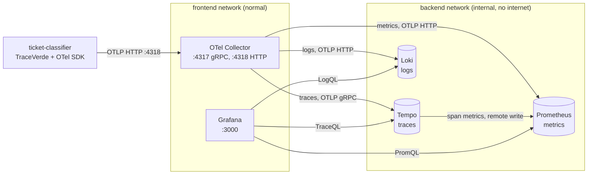
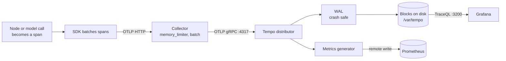
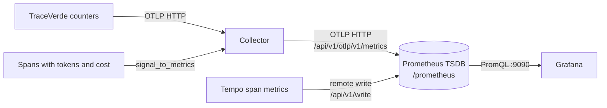
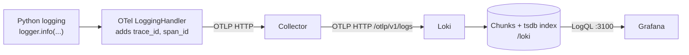
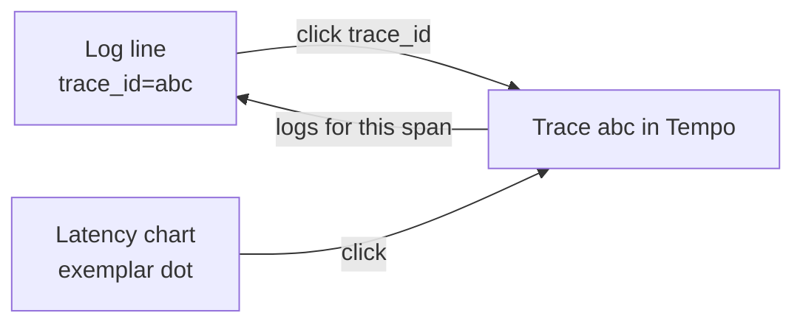

# Monitoring stack

Local only observability for the ticket classifier: metrics, traces and logs, sent with
OpenTelemetry (OTLP), stored on this machine and shown in Grafana. No telemetry leaves
the machine. Build plan: [docs/exercises/plan_w8d5.md](../docs/exercises/plan_w8d5.md).

## Commands

Run from `ticket-classifier/`:

```sh
make obs-up      # start the stack; Grafana at http://localhost:3000 (user admin)
make obs-check   # OK / FAIL per service, with the reason on failure
make obs-usage   # disk usage per volume
make obs-down    # stop the stack; data is kept
```

`docker compose -f monitoring/docker-compose.yml down -v` also deletes all stored
metrics, traces, logs and Grafana data.

Grafana login: user `admin`. The first password is `GRAFANA_ADMIN_PASSWORD` (default
`admin`); Grafana asks to change it on first login. The changed password is stored in
the `grafana-data` volume, so the variable has no effect after the first start.

Variables for the stack, such as `GRAFANA_ADMIN_PASSWORD`, go in `monitoring/.env`
(git-ignored), which compose reads. Not in the app's `.env`: the app rejects unknown
keys there.

## Use it

Telemetry is off by default. Turn it on for one command, or set it in the app's `.env`:

```sh
OTEL_ENABLED=true make run                              # calls the Anthropic API
OTEL_ENABLED=true make approve TICKET=T-1001 NOTE="..."
OTEL_ENABLED=true make kb-index                          # local model, no API cost
OTEL_ENABLED=true OTEL_EXPORTER_OTLP_ENDPOINT= make run # print to the console instead
```

A new trace can take up to about 30 seconds to show up in search.

Three dashboards, linked at the top of each:

| Dashboard | Shows |
| --- | --- |
| [Ticket Classifier](http://localhost:3000/d/ticket-classifier) | metrics: tickets, latency, tokens, cost |
| [Traces](http://localhost:3000/d/ticket-classifier-traces) | ticket runs, paused and failed tickets, slow model calls, weak policy matches (threshold in the `weak_score` box), replies without sources |
| [Logs](http://localhost:3000/d/ticket-classifier-logs) | log volume and lines, by ticket or search text |

To jump between signals:

- **Trace → logs:** open a trace, click a span, then **Logs for this span**.
- **Log → trace:** in Loki, expand a line, then **View trace**.

A `run` and its later `resume` are two traces. `ticket_id` connects them.

## Query cookbook

Paste one query (without its `#` title) into Grafana → Explore. All were tested against
this stack; some return nothing until a run produces a match.

### Tempo (TraceQL)

```text
# All commands
{resource.service.name="ticket-classifier" && name=~"ticket-classifier (run|resume|kb-index|kb-eval)"}

# All traces of a ticket
{resource.service.name="ticket-classifier" && span.ticket_id="T-1001"}

# Ticket runs that did work
{resource.service.name="ticket-classifier" && name=~"ticket\\.(run|resume)" && span.ticket.reused = nil} | select(span.ticket_id, span.run_mode, span.ticket.status, span.category, span.priority)

# Paused tickets
{resource.service.name="ticket-classifier" && span.ticket.status="paused" && span.ticket.reused = nil} | select(span.ticket_id, span.run_mode, span.ticket.status, span.category, span.priority)

# Failed tickets
{resource.service.name="ticket-classifier" && name=~"ticket\\.(run|resume)" && status=error} | select(span.ticket_id, span.run_mode, span.ticket.status, span.category, span.priority)

# High priority tickets
{resource.service.name="ticket-classifier" && name=~"ticket\\.(run|resume)" && span.priority="high"} | select(span.ticket_id, span.run_mode, span.ticket.status, span.category, span.priority)

# Policy passages per ticket
{resource.service.name="ticket-classifier" && name=~"ticket\\.(run|resume)" && span.knowledge.passages > 0} | select(span.ticket_id, span.knowledge.top_score, span.knowledge.sources)

# Weak policy matches (best passage passed the 0.65 minimum, but is below 0.7)
{resource.service.name="ticket-classifier" && name=~"ticket\\.(run|resume)" && span.knowledge.top_score < 0.7} | select(span.ticket_id, span.knowledge.top_score, span.knowledge.sources)

# Tickets without policy passages
{resource.service.name="ticket-classifier" && name=~"ticket\\.(run|resume)" && span.knowledge.passages = 0} | select(span.ticket_id, span.category, span.priority)

# Tickets that got one policy part (matches any element of the list)
{resource.service.name="ticket-classifier" && span.knowledge.sources = "warranty.md#3"} | select(span.ticket_id, span.knowledge.sources)

# Tickets that needed a reworded search
{resource.service.name="ticket-classifier" && name=~"ticket\\.(run|resume)" && span.knowledge.attempts > 1} | select(span.ticket_id, span.knowledge.attempts, span.knowledge.retrieval_ok)

# Replies without sources
{resource.service.name="ticket-classifier" && name=~"ticket\\.(run|resume)" && span.reply.has_sources = false} | select(span.ticket_id, span.knowledge.passages, span.knowledge.dropped)

# Replies that cite one policy part
{resource.service.name="ticket-classifier" && span.reply.sources = "refunds.md#1"} | select(span.ticket_id, span.reply.citations, span.reply.sources)

# Retrieval steps over 100 ms
{resource.service.name="ticket-classifier" && name="langgraph.node.retrieve_knowledge" && duration > 100ms}

# Model calls over 1 s
{resource.service.name="ticket-classifier" && name="anthropic.messages.create" && duration > 1s}

# Traces with any error
{resource.service.name="ticket-classifier" && status=error}
```

`span.ticket.reused = nil` leaves out runs that only read a saved result. `| select(...)`
adds columns to the result table.

### Loki (LogQL)

```text
# All log lines
{service_name="ticket-classifier"}

# Lines of one ticket
{service_name="ticket-classifier"} | ticket_id="T-1001"

# Warnings and errors
{service_name="ticket-classifier"} | severity_text=~"(?i)warn.*|error|fatal|critical"

# Lines of one trace
{service_name="ticket-classifier"} | trace_id="<trace id>"

# Text search
{service_name="ticket-classifier"} |= "waits for a human"

# Policy passages found per ticket (citations and scores)
{service_name="ticket-classifier"} |= "policy passages"

# Tickets where passages fell below KNOWLEDGE_MIN_SCORE
{service_name="ticket-classifier"} |~ "[1-9][0-9]* below the minimum score"

# Lines per level
sum by (severity_text) (count_over_time({service_name="ticket-classifier"}[1h]))

# Lines per ticket
sum by (ticket_id) (count_over_time({service_name="ticket-classifier"} | ticket_id!=""[24h]))
```

### Prometheus (PromQL)

```promql
# Ticket runs
sum(sum_over_time(tickets_runs_total{service_name="ticket-classifier",run_mode="run"}[24h]))

# Tickets by status
sum by (ticket_status) (sum_over_time(tickets_runs_total{service_name="ticket-classifier"}[24h]))

# Tickets by category
sum by (category) (sum_over_time(tickets_runs_total{service_name="ticket-classifier",run_mode="run"}[24h]))

# Tickets by priority
sum by (priority) (sum_over_time(tickets_runs_total{service_name="ticket-classifier",run_mode="run"}[24h]))

# Input tokens
sum(sum_over_time(llm_input_tokens_total{service_name="ticket-classifier"}[24h]))

# Output tokens
sum(sum_over_time(llm_output_tokens_total{service_name="ticket-classifier"}[24h]))

# Cost by model
sum by (gen_ai_request_model) (sum_over_time(llm_cost_usd_total{service_name="ticket-classifier"}[24h]))

# Cost per ticket run
sum(sum_over_time(llm_cost_usd_total{service_name="ticket-classifier"}[24h])) / sum(sum_over_time(tickets_runs_total{service_name="ticket-classifier",run_mode="run"}[24h]))

# Tokens per model call
sum(sum_over_time(llm_input_tokens_total{service_name="ticket-classifier"}[24h])) / sum(sum_over_time(llm_calls_total{service_name="ticket-classifier"}[24h]))

# p95 latency per node
histogram_quantile(0.95, sum by (le, span_name) (rate(traces_spanmetrics_latency_bucket{service="ticket-classifier",span_name=~"langgraph\\.node\\..*"}[24h])))

# Span calls by status
sum by (span_name, status_code) (increase(traces_spanmetrics_calls_total{service="ticket-classifier"}[24h]))
```

`llm_*` and `tickets_runs_total` are deltas: use `sum_over_time`. `traces_spanmetrics_*`
are normal counters: use `rate` or `increase`.

## Overview



- The app pushes everything to one place, the collector. It never talks to a store.
- The collector splits the data by signal and pushes each to its store.
- Grafana only reads: it queries each store with that store's query language.
- Host ports (all on `127.0.0.1`): `4317`, `4318` and `13133` (collector health), and
  `3000` (Grafana). Prometheus, Tempo and Loki have no host ports.

## The three signals

| Signal | What it answers | Example |
| --- | --- | --- |
| Trace | What happened in one run, step by step, how long each step took | ticket T-3: `get_customer` 2 ms, `retrieve_knowledge` 16 ms, `triage` 1.8 s, `human_review` paused |
| Metric | How much, how often, over time (numbers only) | tokens per hour, cost per day, p95 latency of `triage` |
| Log | What a step said, as text with attributes | `Ticket T-3 waits for a human` |

A trace is a tree of **spans**. A span is one timed step (a node, a model call) with a
name, start, duration, status and attributes. All spans of one run share a `trace_id`.

### Traces



- **Generated by:** our code (a root span per CLI command, a span per ticket) and
  below it TraceVerde (LangGraph graph and node spans) and the Anthropic SDK
  (model calls):

  ```text
  ticket-classifier run | resume        cli.py
  └─ ticket.run | ticket.resume         telemetry.ticket_span, one per ticket
     └─ langgraph.graph.stream          TraceVerde, session.id = ticket id
        ├─ langgraph.node.<node>        TraceVerde, e.g. retrieve_knowledge, triage
        │  └─ anthropic.messages.create Anthropic SDK: tokens; TraceVerde: cost
  ticket-classifier kb-index | kb-eval  cli.py, no child spans
  ```

  The knowledge base has no spans of its own: only the Anthropic and LangGraph
  instrumentations are on, so the PostgreSQL queries and the embedding model are not
  traced. Their time is inside the `langgraph.node.retrieve_knowledge` span.

- **Status:** ticket spans have `ticket.status` (`finished`, `paused`, `failed`).
- **Knowledge:** ticket spans have `knowledge.passages` (count), `knowledge.dropped`
  (found, but below `KNOWLEDGE_MIN_SCORE`), `knowledge.sources` (citations such as
  `refunds.md#2`, best first) and `knowledge.top_score` (cosine similarity of the
  best passage; missing without passages), `knowledge.attempts` (searches, with
  rewords) and `knowledge.retrieval_ok` (the last search passed the minimum score).
  They are read from the saved state, so a reused run has them too. The search
  queries are never exported.
- **Reply:** ticket spans have `reply.citations` (count), `reply.sources` (the cited
  passages, in order of first use) and `reply.has_sources`. Never the reply text or
  the quotes.
- **Pauses:** a ticket waiting for a human has `ticket.status=paused` on its span,
  and a `paused` event when the run stops. It is not an error.
- **Stored:** Tempo first writes spans to a write-ahead log (WAL), then packs them into
  compressed blocks.
- **Extra:** the metrics generator turns spans into metrics (call count, errors and
  latency per span, and a service graph) and pushes them to Prometheus.

### Metrics



- **Generated by:** the collector (`llm_calls_total`, `llm_input_tokens_total`,
  `llm_output_tokens_total`, `llm_cost_usd_total`, derived from span attributes,
  `tickets_runs_total`), TraceVerde (`gen_ai_requests_total`) and Tempo (span metrics).
- **Query:** `llm_*` and `tickets_runs_total` are stored as deltas (experimental
  Prometheus feature), so a short CLI run keeps its first value. Use
  `sum_over_time(metric[range])`; `rate` and `increase` give wrong results on them.
- **Stored:** Prometheus' time series database. Resource attributes such as
  `service.name` are copied to labels, so queries can filter by them.

### Logs



- **Generated by:** the app's normal Python logging, only the `ticket_classifier.*`
  loggers (not the OTel SDK, TraceVerde or Anthropic), INFO and above. Export is
  opt-in: only lines written with `safe_log` reach Loki, all others stay on the
  console.
  Lines inside a ticket span get `ticket_id` and `thread_id` automatically; other
  fields passed as `extra={...}` become log attributes too.
- **Stored:** Loki indexes only a few labels (such as `service_name`). Log attributes
  (such as `ticket_id`) are stored as structured metadata: you can filter by them, but
  they don't grow the index.

## How the signals link



- Logs carry the `trace_id` of the span they were written in.
- Span metrics carry exemplars: sample points with the trace id that caused them.
- Grafana's data sources are set up so you can jump between them (step 6).

## Storage and retention

| Component | Data | Volume | Retention |
| --- | --- | --- | --- |
| Prometheus | metrics | `prometheus-data` | 14 days or 1 GB, whichever comes first |
| Tempo | traces | `tempo-data` | 14 days (no size limit for local storage) |
| Loki | logs | `loki-data` | 14 days (compactor deletes old data) |
| Grafana | dashboards, users | `grafana-data` | kept |
| Collector | nothing on disk | none | in-memory queue only |

The volumes have no size quota on macOS. Docker Desktop's disk image size
(Settings → Resources) is the hard limit for all of Docker.

## Privacy

- Prometheus, Tempo and Loki are on an `internal` network: they cannot reach the
  internet.
- Usage reports are off in Tempo, Loki and Grafana. Grafana's update checks, news feed,
  Gravatar, external snapshots and plugin preinstall are off too.
- The collector and Prometheus send no telemetry of their own.
- The Anthropic client sends no trace headers (`propagation: False`) and keeps prompt
  and answer text off its spans (`metadata_only`).
- The collector removes error messages and stack traces from all spans, because they
  can quote tickets or model output. Error types stay. If this step fails, the batch
  is dropped.
- Content capture is forced off, and OTLP settings per signal are ignored, whatever
  the environment says.
- Spans hold no prompt or answer text; Loki gets no ticket, customer or reviewer
  text.
- Policy passages reach spans and Loki only as citations and scores, never their text
  or the query (the ticket text).
- The knowledge base is local too: the embedding model runs on this machine
  (Hugging Face telemetry off), and PostgreSQL ([database/](../database/)) is not part
  of this stack and sends nothing.
- `output/trace.jsonl` has the full graph states, including passages. It stays a local
  file and is not exported.
- The app itself still sends ticket and customer data to the Anthropic API: that is
  how it classifies tickets.
- Grafana and the collector are on the normal network. Grafana may download a missing
  bundled plugin from grafana.com at startup; it has no documented off switch.

## Files

| File | Role |
| --- | --- |
| `docker-compose.yml` | services, networks, volumes, ports |
| `otel-collector/config.yaml` | receivers, processors, exporters, pipelines |
| `prometheus/prometheus.yml` | OTLP settings, self scrape |
| `tempo/config.yaml` | receiver, storage, metrics generator, retention |
| `loki/config.yaml` | storage, schema, retention, OTLP limits |
| `grafana/provisioning/` | data sources and dashboard provider |
| `grafana/dashboards/` | the three dashboards (JSON) |
